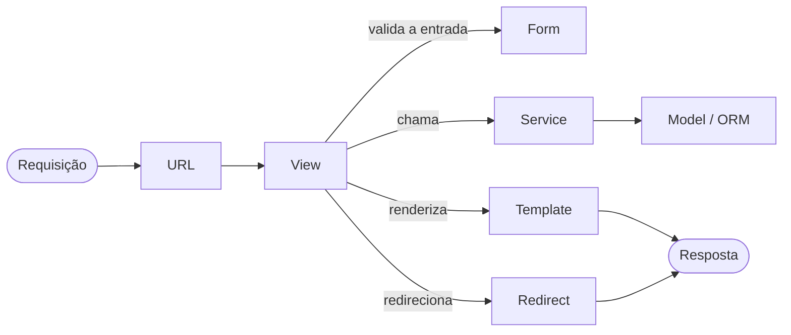

# Arquitetura

O projeto segue MVT, com as regras de negócio concentradas na camada de service. O motivo dessa decisão está na [ADR 0001](adr/0001-mvt-com-camada-de-service.md).

## Fluxo de uma requisição



## Views (`<app>/views/`)

- Toda view é uma classe que herda diretamente de `django.views.View`.
- Implemente apenas os métodos HTTP necessários (`get`, `post`).
- Mixins de controle de acesso, como `LoginRequiredMixin`, são permitidos.
- Não use views baseadas em função nem generic views (`ListView`, `CreateView` etc.).
- A view só recebe a requisição, chama o service e retorna a resposta (template ou redirect).
- A view não contém regra de negócio nem acessa o ORM diretamente. Por isso, não usa `get_object_or_404`.
- `login()` e `logout()` são chamados na view, pois alteram a sessão HTTP e precisam de `request` ([ADR 0002](adr/0002-modelo-de-usuario-customizado.md)).

## Forms (`<app>/forms/`)

- Validam o formato da entrada e renderizam os campos.
- A gravação é feita pelo service, sem `form.save()`.

## Services (`<app>/services/`)

- Toda regra de negócio fica aqui, incluindo validações de negócio e consultas ao ORM.
- Services não recebem `request` nem retornam `HttpResponse`.
- Falhas são comunicadas por exceções de domínio (`<app>/exceptions.py`), que a view converte em respostas HTTP.

## Models (`<app>/models/`)

- Definem campos, relacionamentos e metadados, sem regra de negócio.

## Templates

- Cuidam apenas da apresentação, sem lógica de negócio.

## Admin

- O Admin não deve ignorar as regras dos services: suas ações chamam os services, e a escrita fica bloqueada nos models cujas regras dependem deles.

## Exemplos

Leitura:

```python
class MinhasOcorrenciasView(LoginRequiredMixin, View):
    def get(self, request):
        ocorrencias = OcorrenciaService.listar_para_cidadao(request.user)
        return render(
            request,
            "ocorrencias/minhas-ocorrencias-cidadao.html",
            {"ocorrencias": ocorrencias},
        )
```

Alteração, com a exceção de domínio convertida em resposta HTTP:

```python
class CancelarOcorrenciaView(LoginRequiredMixin, View):
    def post(self, request, protocolo):
        try:
            OcorrenciaService.excluir_logica_cidadao(protocolo, request.user)
        except OcorrenciaNaoEncontradaErro as exc:
            raise Http404 from exc
        except OcorrenciaEmAndamentoErro as exc:
            messages.error(request, str(exc))
            return redirect("minhas_ocorrencias")
        messages.success(request, "Ocorrência cancelada com sucesso.")
        return redirect("minhas_ocorrencias")
```
